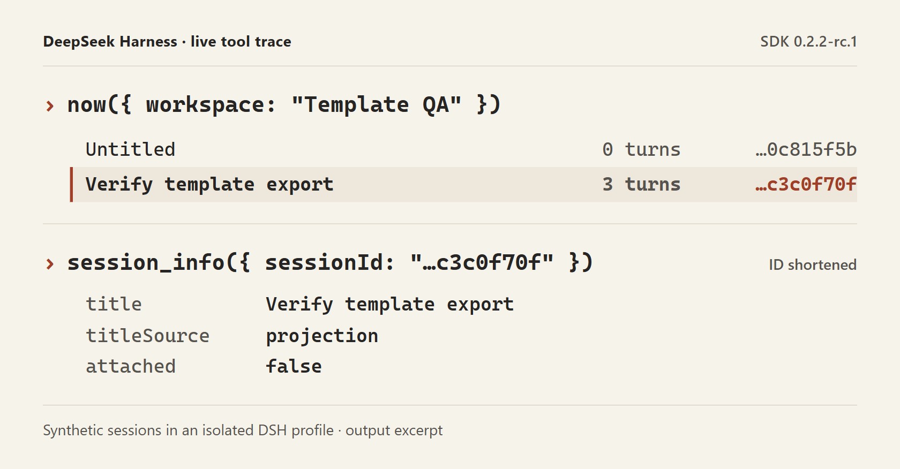

# DSH Agent Ops

Find the DeepSeek Harness conversation you want to resume. Agent Ops shows workspaces, resolves session titles and surfaces relevant conversations by recency, including sessions whose agent is closed.



*Output excerpt from a real DSH 0.2.2-rc.1 SDK run. The sessions are synthetic and their IDs are shortened. The untitled entry has a first human prompt, so it still appears in the results.*

## Try it

Tested on Windows with Node.js 24.14.0 and the DSH SDK profile at **0.2.2-rc.1**. Download the [v0.1.0 install package](https://github.com/XcapeAxis/dsh-agent-ops/releases/download/v0.1.0/dsh-agent-ops-0.1.0.tgz), then run this in the download directory. An isolated DSH home lets you try the package with its own profile.

```powershell
$env:DSH_HOME = Join-Path $PWD 'agent-ops-demo-home'
dsh plugin --profile sdk add ./dsh-agent-ops-0.1.0.tgz
```

Connect an SDK client to that DSH profile. After creating a few conversations, ask: “Show my workspaces, then use `now` to find the most recent conversation in the project I name.” Use `session_info` to confirm the match. If the profile is empty, the workspace and session lists will be empty too.

| Tool | Result |
| --- | --- |
| `workspace_list` | Registered workspaces and their session counts |
| `session_list` | Sessions grouped by workspace, excluding archived and delegated sessions by default |
| `now` | Recent sessions across workspaces, optionally narrowed by workspace name. Hides confirmed blank cold sessions. |
| `session_info` | One session's title, state and workspace membership |

Cold titles come from DSH's local projection cache. When an untitled session has a first human prompt or unconfirmed metadata, `now` can still show it. Session results can include a short preview of the first human prompt, as well as paths and titles. Use the tool in a trusted single-user profile.

To remove the package from that same profile:

```powershell
dsh plugin --profile sdk remove dsh-agent-ops
```

## 验证结果

在隔离的 SDK profile 中从实际发布包安装，由 DSH 真实工具执行器查询两个合成工作区。成功找到一条已冷却的会话，过滤了各一条归档、空白与子代理会话。查询前后七个工作区及投影数据文件的 SHA-256 一致，卸载后重启确认四个工具均不再出现。验证没有调用模型。桌面端与其他 DSH 版本尚未验证。

[实测回执](docs/host-verification.json)。v0.1.0 只注册上述四项查询工具，支持读取标题与归属。安装会更新所选 profile 的插件清单，查询本身不修改会话或写入记忆。

MIT · WeiHeng Xue (XcapeAxis).
